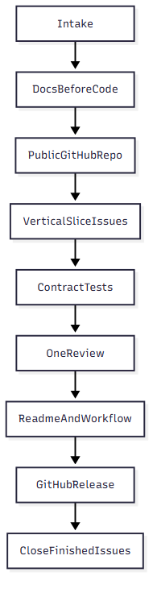

<p align="center">
  
</p>

# launch-project

Cursor skill that bootstraps a new project with docs, a free stack, a public repo, and one review.

<p>
  
  
  
</p>

**Live:** the skill is this repository. There is no hosted app.

## What it does

launch-project is a Cursor skill for developers who start a new repo and want the same path every time. It writes the brief before code, picks a free stack, opens a public MIT repository, and stops after one review. Later sessions read a status file instead of rereading the tree.

## Workflow



## How to run

Requirements: Node.js 22 and npm.

```bash
npm install
npm run dev
npm test
npm run build
```

Install the skill into Cursor:

```bash
npx skills add mafzalkalwardev/launch-project --skill launch-project
```

`npm run dev` starts Vitest in watch mode. `npm test` runs the contract check once. `npm run build` typechecks the tests. Details are in `docs/RUNBOOK.md`.

## Discovery

This repository is a library, so it has no site metadata. The answer above is the quotable description. Search should use the GitHub description, topics, and this README.

## License

MIT. See `LICENSE.md`.
